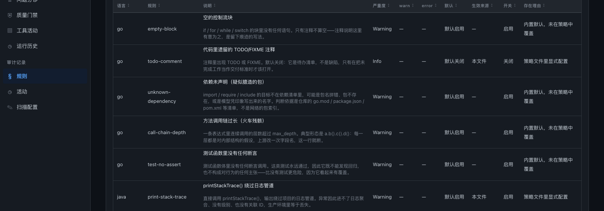
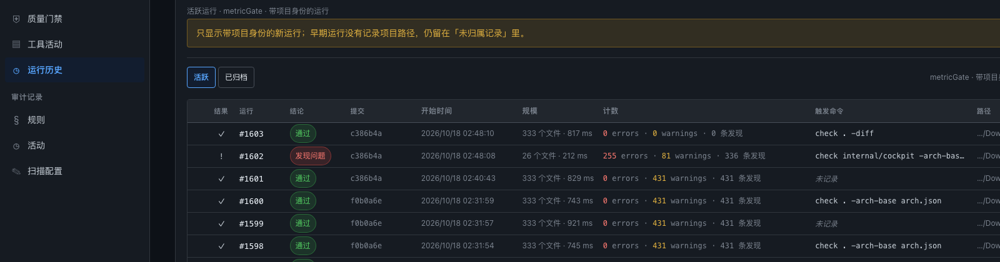

# iter-29 整改实测：五项改动的前后对比

日期：2026-10-18　状态：**已执行**
上游：[iter-29 中期清点](../iterations/iter-29-midterm-backlog-audit.md)（排期来源）　[iter-28](../iterations/iter-28-cockpit-dark-and-store-retention.md)　[iter-27](../iterations/iter-27-manual-handoff-blockers.md)

## 0. 一句话结论

五项全部合入 main（`275ee38..c386b4a`，31 文件 +2686 −211）。**两条是度量正确性**：TS/JS 模块级箭头函数从「整文件不可见」变成可量（同一段代码可维护性指数 19 → 51），`test-no-assert` 在 110 个真实 `_test.go` 上误报 55 → 19（本仓 8 → 0）。**三条是可达性**：规则目录中文到前端、运行历史记录触发命令、harness 接线样例落地。**本仓 gate 从 422 warnings 到 431（+9），0 errors 不变，PASSED 不变**——+16 来自新暴露的 TS 函数，−8 来自误报清零，净增 9 条里有 1 条是本轮新写的代码自己越线（已重构消化，见 §4.3）。

## 1. 口径

| 项 | 值 |
|---|---|
| 基线树 | `275ee38`（iter-29 排期文档那个 commit = 本轮五项之前），worktree 在 `/tmp/mg-base-tree` |
| 基线二进制 | `/tmp/mg-before`（`go build ./cmd/metricgate` 于基线树） |
| 整改后 | `main` = `c386b4a`，二进制 `/tmp/mg-check` / `/tmp/mg-inv` |
| gate 命令 | `check . -arch-base arch.json` |
| 语料 | `/tmp/corpus` = 5 个开源 Go 包，110 个 `_test.go`（go-humanize v1.0.1、google/uuid v1.6.0、google/pprof、mattn/go-isatty、modelcontextprotocol/go-sdk v1.8.0） |
| 复现 | 全部命令写在 §6，逐条可跑 |

一句话说明为什么不比"通过率"：本轮五项里没有一项改变 error 判定，比 error 数会得到"什么都没变"的结论。可比的是**同一份代码在两个二进制下各自量出多少东西**，所以每一项都配一个最小 fixture 加真实语料。

## 2. 五项与五个 commit

| # | 项 | commit | 类型 | 关键文件 |
|---|---|---|---|---|
| R1 | TS/JS 模块级箭头函数算函数单元 | `760f498` | 度量正确性 | `internal/metrics/js_adapter.go`、`kindset.go`、`metrics.go` |
| R2 | `test-no-assert` 认「拿到 `*testing.T` 的 helper」 | `ecd57b5` | 规则正确性 | `internal/rules/go_test_no_assert.go` |
| R3 | `.claude/settings.json.example` 发货 | `ec1455c` | 文档承诺兑现 | `.claude/settings.json.example`、`.gitignore` |
| R4 | 规则目录中文到前端 | `f0b0a6e` | 可解释性 | `internal/cockpit/rules_zh.go`、`rules_api.go`、`web/app.js` |
| R5 | 运行历史记录触发命令与路径 | `c386b4a` | 可追溯性 | `cmd/metricgate/invocation.go`、`internal/store/*`、`web/app.js` |

## 3. R1：箭头函数从不可见到可量

### 3.1 缺陷形状

`internal/metrics/kindset.go` 的 `tsFuncKinds` / `tsxFuncKinds` / `jsFuncKinds` 只含 `function_declaration`、`generator_function_declaration`、`method_definition` 与 class 声明。`export const handler = (x) => {…}` 在 tree-sitter 里是 `variable_declarator` 的 `value=arrow_function`，**不属于任何一个 kind**。后果不是"少一个度量"，是这个函数在整套阈值面前不存在。

`docs/metrics.md` 原本把这个失明写成设计说明（"函数表达式不计入"），所以它长期不被当作缺陷。

### 3.2 修法：结构判据，不是 kind 判据

`internal/metrics/js_adapter.go` 新增 `isJSModuleFunc(n *sitter.Node) bool`，四个条件全满足才算单元：

1. 父节点是 `variable_declarator` 且 `value` 字段命中该节点 —— **必须比 span 不能比指针**，`ChildByFieldName` 每次返回新 wrapper，比指针曾导致 FUNCS=0 回归；
2. 祖父是 `lexical_declaration` / `variable_declaration`；
3. 曾祖父是 `program` **或 `export_statement`**（漏了 `export_statement` 时 `export const f = () => {}` 仍然不可见，这是第一版失败的原因）；
4. 节点 kind 在 `jsModuleFuncKinds`（`arrow_function` / `function_expression` / `generator_function`）。

`LangProfile` 新增字段 `NamedFuncUnit func(n *sitter.Node) bool`，`HasFunc` 改成「kind-set 命中 **或** NamedFuncUnit 命中」。名字取 declarator 的 `name` 字段（`jsDeclName`），无括号单参箭头（`x => x + 1`）的参数在 `parameter` 字段而非 `formal_parameters`，`jsSingleParamNode` 补这一格。

### 3.3 刻意不做的两件事（都有测试钉住）

- `export default () => {…}` **不算单元**：没有名字可报，造一个名字等于往快照里塞假标识符。
- 内联闭包 `a.map((y) => { if (y) … })` **仍折叠进外层**（与 Go `func_literal` 同规则，`engine.go` 的 nesting bonus）。否则 `a.map(f)` 会被双算：外层算一次、每个回调再算一次，fan-out 与 cyclomatic 同时虚高。

这两条不是保守，是让「一个单元 = 一个可命名的决策点」这个定义在 Go 和 TS 之间保持同一个意思。

### 3.4 实测

fixture `/tmp/eval29/ts/handler.ts`：一个 8 分支的 `export const handleOrder = (order, ctx) => {…}` + 一个 `export function legacyHelper`。

| | snapshots | 函数单元 | 文件可维护性指数 |
|---|---|---|---|
| 基线 `275ee38` | 10 | 仅 `legacyHelper` | **19** |
| main `c386b4a` | 18 | `legacyHelper` + `handleOrder` | **51** |

新增的 8 个度量：cognitive 9 / cyclomatic 8 / npath 48 / length 23 / nesting 2 / fan-out 1 / params 2 / boolean-params 0。

fixture `/tmp/eval29/ts2/arrows.ts`（全箭头 + 一个 `export default`）：基线测到的函数名集合是 `['']`（**FUNCS=0，整文件不可见**）；main 是 `['', 'clamp', 'formatRatio', 'toPercent']`。

**同一个文件、同一套阈值，指数从 19 跳到 51。** 这不是阈值调了，是基线那个数字压根没把主函数算进去——它低不是因为代码好，是因为代码没被看见。

### 3.5 自食其果

修好后本仓自己的 `internal/cockpit/web/app.js` 冒出 27 个此前从未被任何阈值看过的函数，其中 3 个真越 error 阈值：`policyPane` cyclomatic 30 / length 68、`scopeAggregate` cyclomatic 22。

策略文件（`iter-28` §）明写「the answer is to cut a page, not to raise this number again」，所以做的是拆分而不是抬阈值：

- `scopeAggregate` 抽出 `unionRunsBy(lists)` 与 `runId(row)`
- `policyPane` 抽出 `policyEditorPanel` / `policyDiskVersion` / `policyKeysPanel` / `policyChainPanel` / `policyChainStep` / `policySectionsPanel`

gate 从 FAILED（3 errors）回到 PASSED。抬阈值能在一分钟内让这 3 条消失，但那等于用「把灯拧亮」解决「找不到钥匙」。

## 4. R2：`test-no-assert` 的误报

### 4.1 原判据错在哪

`isAssertionCallee`（`internal/rules/go_test_no_assert.go:75`）是一张词表：`assert.*` / `require.*` / `must*` / `t.Error|Fatal|Fail` / `panic`。任何自定义 helper 都不认，于是本仓 `internal/facts/lang_test.go` 的 `wantVis` / `wantDef` 各报一条——**而这些 helper 内部就是 `t.Fatalf`，测试当然能失败**。规则在撒谎。

### 4.2 修法：能力判据

`goBlockHasAssertion` 多收一个参数（从函数签名解析出的 `T` 形参名），两档判据：

1. 调用名在断言词表里（原有）；
2. **调用的实参里有那个裸标识符** → helper 拿到了 `*testing.T`，就拿到了让测试失败的手段。

判据 2 的理由写在代码注释里：一个 helper 能失败这个测试，当且仅当它拿到了失败的手段。这是能力，不是名字。

### 4.3 实测（110 个真实 `_test.go`）

| | 基线 | main |
|---|---|---|
| 命中总数 | **55** | **19** |
| 其中 `Benchmark*` | 17 | 14 |
| 其中 `Test*` | 38 | 5 |

剩下 5 个 `Test*` 逐条抽查全为真报：`TestTerminal`（只有 `t.Log`，注释写着 "test for non-panic"）、`TestSetTools`（只调两次 setter）、`TestAddToolInputSchemaComposition`、`TestSetFastSymbolization`、`TestThreadSafety`。本仓 8 → 0。

`Benchmark*` 那 14 条本轮不动：benchmark 没有断言是常态，但词表判据下 `b.Fatalf` 算断言，剩下的确实一个都没失败手段。要不要为 benchmark 单开一档是产品决定，不是 bug（记进 §7）。

精度下界也钉进了测试：`tt := t; check(tt, true)` 这种**别名**仍会被 flag。追别名要做数据流分析，这条规则从来不做数据流——所以宁可留这一格不完美，也不假装它不存在。

新增两个表驱动测试（`internal/rules/rules_test.go`）：`TestGoTestNoAssertHelperCapability`（用例源里 3 条应报 / 2 条不得报）、`TestGoTestNoAssertNamesAnyTParam`（`*testing.B`、改名参数 `tb` 天然覆盖；精度下界 1 条真报 `TestPassesAnAlias`）。注意 `TestUsesHelper` / `TestHelperWithoutT` 这些名字是**测试夹具源码里的函数名**，不是新增的 Go test。

反向验证：临时建一个真的没有断言的测试文件，规则必须恰好 flag 它 1 条 —— 证明放宽没有把规则放宽成常量 false。

## 5. R3 / R4 / R5：三条可达性

### R3 `.claude/settings.json.example`

`docs/workflow.md:108` 写着「已发货：`hooks/post-edit.sh` + 一个不启用的示例 `.claude/settings.json.example`」。hook 在 main 上（12 passed），**样例文件不存在**。

真正的坑不是写文件，是让它能被 `git add`：开发者的**全局** `core.excludesFile`（`~/.gitignore:9` 一条裸 `.claude`）剪掉了整个目录，而 Git 对被忽略的目录**剪枝**，其下的取反规则读不到。所以仓库 `.gitignore` 必须是三行、且顺序即语义：

```
!/.claude/
/.claude/*
!/.claude/settings.json.example
```

`git check-ignore -v` 对取反规则返回 rc=0 并指明命中 `!` 行，很容易读反。真判据是走完文档接线流程：`cp example → settings.json` → 替换 `<ABS_PATH>` → 喂 `{"tool_input":{"file_path":…}}` 给 `hooks/post-edit.sh` → 输出 scope 行 + `exit 0`。已实跑通过。

顺带修断链：`docs/research/v02-requirement-schedule.md:86` 的 `../../iterations/…` → `../iterations/…`。

### R4 规则目录中文

`/api/rules?scope=all` 实测：13 门语言、61 条规则行、**7 个 distinct rule id**（`empty-block` / `todo-comment` / `unknown-dependency` / `call-chain-depth` / `test-no-assert` / `print-stack-trace` / `silent-catch`），61 行全部带 `titleZh`，无中文的 id 集合为空。度量类规则（function-length 等）不是 rule pack 成员，不在这 61 行里——这点原先被误读成"中文表漏了度量规则"。

`rules_catalogue_test.go` 的 `TestRuleChineseTablesCoverEveryBuiltinRule` 遍历每门语言的 pack，缺中文即 fail，所以这张表不会随规则增加而悄悄过期。

前端做最小嫁接（没有整体搬分支版 `app.js`，因为分支版依赖 main 上不存在的 `tablePager` / `pageRuleGroups` / `RULES_LANG_ALL`）：`ruleCopy(rule)` 回退英文 title、**不编造 desc**。



两个值得记的坑：

1. `<th>` 的属性顺序会静默关掉一整列的测试。`render_all.mjs` 的表头正则锚定在 `<th aria-sort="…"` 紧跟 `>`，任何插在 `<th` 与 `aria-sort` 之间的属性（比如 tooltip）会让该列**从所有断言里消失而不是失败**。修法：hint 落内层 `<button>`。现在多一条断言「every sortable column must be visible to the checks」兜这个。
2. 用 heredoc 改 CSS 时 `''''` 被解析成三引号加一个撇号，把 `'` 真写进了 `style.css`，`.rule-desc` 失效且其后规则解析被破坏 → 「默认启用」折成「默认启/用」。**源码 grep 看不出问题**，是 `curl …/style.css` 加截图才发现的。

### R5 触发命令

`runs` 表此前 13 列，没有任何一列记录「这些数字是怎么来的」。加可空 `invocation TEXT`（走既有 `migrate()` steps 模式），CLI 在 `check_cmd.go` 组装 `store.RunMeta` 时写 `invocationLine()`。

**脱敏是这一项的真实工作量**：命令行会带 `--token`、`-password`、`ghp_…`。`cmd/metricgate/invocation.go` 三招：

- `secretFlags` 名单（token / password / secret / api-key / authorization / private-key / …）命中时值写成固定串 `<redacted>` —— 不用等长掩码，等长掩码泄露密钥长度；
- 前缀识别兜住没有 flag 名可对的裸值（`ghp_`、`github_pat_`、`AKIA`、`sk-`、`xoxb-` …）；
- `isFlag` 判据：必须 `-` 开头、非 `--`、不含空格。Go flag 包在第一个非 flag 参数后停止解析，所以位置参数 `src/token` 不能吞掉后一个 token。
- 含 shell 元字符的参数加单引号（内嵌 `'` 用 `'\''`），保证这行可以原样粘回终端。

**反向测试**：`TestInvocationDoesNotRedactOrdinaryPaths` 断言 `/home/amy/sk-notes/report.md`、`./tokens.csv`、`secrets-report.sarif` **不得**被抹掉；`TestSecretFlagNamesAreSpelledAsTheFlagsAre` 断言 `secretFlags["config"] == false`。把路径 redact 掉会毁掉这列存在的意义，所以这条边界比 redact 本身更需要测试。共 10 个测试（`cmd/metricgate/invocation_test.go`）+ 3 个 store 往返与迁移测试（`internal/store/invocation_test.go`：`TestRunInvocationRoundTrip` / `TestRunWithoutInvocationReadsBackEmpty` / `TestMigrationAddsInvocationToLegacyRuns`）。

前端两列（`触发命令` / `路径`）：单元格去掉 `argv[0]`（同行之间变的只有 verb 和 flag），完整行进 tooltip；旧行 NULL 显示 `未记录` 而不是空白——空白读起来像"没带 flag 的运行"，那是关于一个 store 里不存在的事实的断言。



**两个只有截图能发现的 CSS bug**（`table-layout: fixed`）：

1. 11 列声明宽之和超过面板可用宽时，fixed 布局**按比例压缩每列**而不是让 wrapper 横向滚动 → `col-cmd` 被压到几个像素。修法：给表 `min-width: 96rem`。
2. 补 min-width 后 `col-counts` 是 `white-space: nowrap` 且无 `overflow: hidden` → 画穿自己边框盖到下一列，看起来像"触发命令"列凭空消失。

两条都补了守卫测试（`internal/cockpit/web_contract_test.go`）：`TestRunTableWidthsAddUp`（列宽之和 vs `min-width`）、`TestRunTableColumnsAreAllDeclared`（表头每个 `col-*` 必须有**带 width 的规则**——只按类名选不够，`.col-path { overflow: hidden }` 什么都没定）。反向验证：改回 `min-width: 90rem` → 报 `runs-table: min-width is 90rem but its 11 columns need 95rem`。

实测：`/tmp/mg-inv check . -diff` 之后 `SELECT id, invocation FROM runs ORDER BY id DESC LIMIT 1` → `1603|/tmp/mg-inv check . -diff`；`#1601` 及更早行为 `<NULL>` → 前端 `未记录`。

## 6. 本仓 gate 的逐规则对比

`check . -arch-base arch.json`，基线 `275ee38` vs main `c386b4a`：

| | errors | warnings | notes | snapshots | gate |
|---|---|---|---|---|---|
| 基线 | 0 | 422 | 0 | 25450 | PASSED |
| main | 0 | 431 | 0 | 27079 | PASSED |
| delta | 0 | **+9** | 0 | +1629 | — |

| rule | before | after | delta |
|---|---|---|---|
| fan-out | 105 | 111 | +6 |
| cyclomatic-complexity | 77 | 83 | +6 |
| npath-complexity | 66 | 68 | +2 |
| cognitive-complexity | 37 | 38 | +1 |
| function-clone | 37 | 38 | +1 |
| params-count | 14 | 15 | +1 |
| **test-no-assert** | **8** | **0** | **−8** |
| banned-fmt-Print* | 4 | 4 | 0 |
| file-length | 34 | 34 | 0 |
| function-length | 31 | 31 | 0 |
| layer-violation | 3 | 3 | 0 |
| unknown-dependency | 2 | 2 | 0 |
| call-chain-depth | 2 | 2 | 0 |
| nesting-depth | 1 | 1 | 0 |
| sdp-violation | 1 | 1 | 0 |

读法：+16 来自 R1（TS 箭头函数变可见后 `app.js` 里新量到的函数），−8 来自 R2 误报清零。R5 自己新写的代码一度给 `runRow` 加了 fan-out 11 和 `storeRun` fan-out 11 两条——用 `git stash` 前后归一化 `(file, rule)` 集合 diff 为空才确认"净新增 0"，靠的是抽 `provenanceCells(run)` 与 `runMeta(cfg)` 两个函数，不是抬阈值。

测试规模：`_test.go` 函数 808 → 853（+45），文件 134 → 138（+4），`go test ./...` 48 包全绿。

### 6.1 把「判据变了」和「代码变了」分开

上表比的是两棵不同的树（`275ee38` vs `c386b4a`），所以 +9 里混着本轮新写的代码。
把**同一棵 main 工作树**分别喂给两个二进制，只剩判据差异：

| 文件 | 规则 | 基线二进制 | main 二进制 | delta |
|---|---|---|---|---|
| `internal/cockpit/web/app.js` | cyclomatic-complexity | 5 | 10 | **+5** |
| `internal/cockpit/web/app.js` | fan-out | 4 | 9 | **+5** |
| `internal/cockpit/web/app.js` | npath-complexity | 0 | 1 | **+1** |
| `internal/cockpit/web/app.js` | params-count | 0 | 1 | **+1** |
| `internal/facts/lang_test.go` | test-no-assert | 6 | 0 | **−6** |
| `internal/cockpit/web_smoke_test.go` | test-no-assert | 1 | 0 | **−1** |
| `internal/metrics/grammar_probe_test.go` | test-no-assert | 1 | 0 | **−1** |
| | | | 净 | **+4** |

**12 条新增全部落在 `app.js` 一个文件上**，8 条消除全部落在三个 `_test.go` 上。这就是
R1 与 R2 的纯效应，没有一行代码在本轮之间被改过。`app.js` 那 12 条里已经扣掉了
§3.5 的拆分成果。作为对照：R1 落地后、拆分前，同一判据下本仓是 **3 条 error / gate FAILED**（`policyPane` cyclomatic 30 与 length 68、`scopeAggregate` cyclomatic 22）；拆完才回到 PASSED。

## 7. 一处必须记录的副作用（已于 iter-30 结清）

`docs/evaluations/evaluation-commit-replay-results.md` 的「**test-no-assert 在 215/289 commit 触发**」是**旧判据**得到的数字，而 R2 改了判据。本文当时说那个语料仓库（marein/dev-cockpit）不在本地、本轮无法重算——**这句错了**：语料可重克隆，归档 JSON 也在 `.data/commit-replay/`。iter-30 已全量重跑（见 [evaluation-iter30-tna-recalibration.md](evaluation-iter30-tna-recalibration.md)）：

- 能说的：**按 commit 计数 215/289 在新旧判据下都成立**，且与归档逐条一致（findings 1,783）。
- 不能说：**215 个独立的伪绿测试**。215 个命中全部来自 `internal/eventbus/eventbus_test.go:40` 同一个函数（自 commits.txt 第 75 个 `444b31ec97` 起，75..289 零漏网）；distinct anchor 31 → 2 → **1**；findings 1,783 → 233 → 215（排除 benchmark）。而且那个函数靠「阻塞即死锁 → 超时」失败，属规则精度下界。
- 本文原先的估计（「按 55→19 的比例，真实数可能显著低于 215」）**方向对、量级错得远**：commit 数根本未变，变的是 anchor 数。读这类比例外推时要记住：它推不出 per-commit 计数。

同类问题在 R1 也存在：`docs/metrics.md` 里任何关于"TS 代码函数级度量覆盖率"的表述都必须在两个二进制下分别标注，否则读者无法判断数字来自失明前还是失明后。

同类问题在 R1 也存在：`docs/metrics.md` 里任何关于"TS 代码函数级度量覆盖率"的表述都必须在两个二进制下分别标注，否则读者无法判断数字来自失明前还是失明后。

## 8. 复现命令

```bash
# 基线树与两个二进制
git worktree add /tmp/mg-base-tree 275ee38
(cd /tmp/mg-base-tree && go build -o /tmp/mg-before ./cmd/metricgate)
go build -o /tmp/mg-check ./cmd/metricgate

# R1 fixture：同一文件 19 → 51
/tmp/mg-before check /tmp/eval29/ts -format json | grep maintainability
/tmp/mg-check  check /tmp/eval29/ts -format json | grep maintainability

# R2 语料：55 → 19
/tmp/mg-before check /tmp/corpus 2>/dev/null | grep -c test-no-assert
/tmp/mg-check  check /tmp/corpus 2>/dev/null | grep -c test-no-assert

# R4 端点：61 行全带中文
curl -s "http://127.0.0.1:8792/api/rules?scope=all" | \
  python3 -c "import json,sys;d=json.load(sys.stdin);r=d['rules'];print(len(r),sum(1 for x in r if x.get('titleZh')))"

# R5 落库
/tmp/mg-check check . -diff
sqlite3 .metricgate/history.db "SELECT id, COALESCE(invocation,'<NULL>') FROM runs ORDER BY id DESC LIMIT 3;"

# 全量回归
go vet ./... && go test ./... -count=1 && node --check internal/cockpit/web/app.js \
  && node internal/cockpit/web/render_all.mjs && bash hooks/post-edit_test.sh
```

## 9. 下一轮 TODO

按「不做会持续污染度量」排序，不按工作量。三类：度量正确性 / 规则与可解释性 / CI 与交付。

### 9.1 度量正确性（P0，会让数字错）

| 项 | 为什么是 P0 | 验收 |
|---|---|---|
| **重跑 commit replay 标定 `test-no-assert`** | §7 的债：claims #19 现在引的是一个已知偏高的数字 | ✅ **iter-30 已做**（289 commit × 双判据重放，215/289 可复现但含义已改；见 `evaluation-iter30-tna-recalibration.md`） |
| **`Benchmark*` 是否单开一档** | R2 剩的 14/19 条都是 benchmark，判据合理但产品噪音 | ✅ **iter-30 已定口径**：`test-no-assert` 改为只管 `Test*`（实测 0 条真阳丢失）；「benchmark 其实什么都没测」归 iter-31 开新规则 |
| **别名追踪（`tt := t`）** | R2 的已知精度下界，已钉进测试 | 要么做（需要一份局部数据流），要么在规则文档明写不追 |
| **C/C++/C# 的等价失明排查** | R1 修的是 JS 系；同类"kind-set 漏掉某种声明形态"在别的语言适配器里大概率还有 | 每种语言写一个"全 lambda/全属性/全表达式体"的 fixture，FUNCS 必须 > 0 |
| **pre-commit 改 scoped check 根** | iter-29 §2.2 实测未做，纯性能（省 1.6–2.05 秒），但它是唯一每天跑的入口 | 同一脏树 `hooks/pre-commit` 前后耗时中位数对比 |

### 9.2 规则与可解释性（P1）

| 项 | 说明 | 验收 |
|---|---|---|
| **`languageGroups` 有数据无消费者** | R4 记下的观察：`/api/rules` 提供 13 个语言分组，`app.js` 与 MCP 工具都不读它 | 前端按语言分组，或删字段。**不要留着**——无消费者的字段会假装自己是需求 |
| **D3「为什么没报」产品化** | iter-29 §2.3 backlog 里唯一一条能提升可信度的：explain 已能答"为什么报"，答不了"为什么没报" | 一条规则 × 一次 suppress 的 explain 输出含抑制原因 |
| **规则中文表扩到度量类规则** | 现在 7 个 id 全覆盖，但 function-length 等度量规则在前端仍是英文 | 度量规则也进中文表，`rules_catalogue_test.go` 扩遍历范围 |
| **`-diff` value-delta 子目录静默** | iter-20 §五 的遗留，需先定口径（退化还是报错） | 同一脏树 `check basepkg -diff` 与 `check . -diff` 的 `unchanged` 不再一个为 0 |

### 9.3 CI 与交付（P1，但**顺序不可调**）

7 个 workflow 全 `disabled_manually`。iter-29 §3.1 的判断仍然成立：**「修好了但停着」等于「不知道还通不通」**。

| 项 | 说明 |
|---|---|
| **恢复 CI 前不要假设链路还好的** | 按 iter-27 §7 顺序重跑证明：合并 → 封板 → 删 label 再跑自举。三段各自的判据在 iter-27 §8.3 |
| **P2 triage push 触发** | 等 CI。CI 停着时加的是不会执行的代码 |
| **P4 分支保护** | 等 CI。没有 required checks 时它守的是空集 |
| **凭证路线收口** | 现在走 A（`mcp.json` 里 Bearer + PAT）。跨机器复现需要 B（`pi mcp login github` 真做一次 OAuth）。`.trellis/spec/backend/tooling-credentials.md` 已记规则，但机器上仍是 A |

### 9.4 一句话

本轮把「度量看不见」和「规则会撒谎」这两类清零了；下一轮该还的是**这些修正让旧评估数字失效**这笔债（§7）——否则我们是在用一套新度量配一份旧结论。
